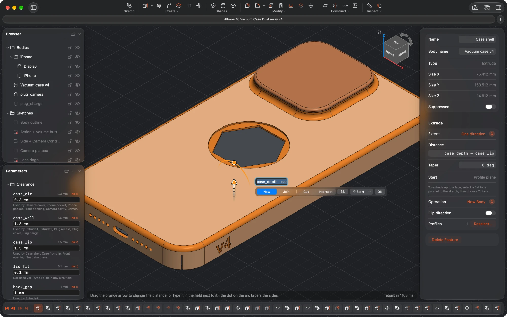

# SimplMaker



A small, native, **parametric** CAD tool for macOS, made for people who 3D print. You sketch, extrude, fillet and chamfer; every
size is an expression that can use named parameters, so changing a number rebuilds the whole part. Free and open source, with no
account, no subscription and no cloud: your parts are plain files on your Mac.

**[Download it](https://simplmaker.com/download/)** · [Documentation](https://simplmaker.com/docs/) · [Report a bug](https://github.com/atlemo/SimplMaker/issues)

SimplMaker runs on macOS 15 or later on Apple silicon. The download is signed and notarized, and updates itself.

## Build it yourself

You need a Mac with Apple silicon, Xcode 26 or later (Swift 6.2), and CMake and Ninja to build the geometry kernel once:

```sh
brew install cmake ninja
git clone https://github.com/atlemo/SimplMaker.git && cd SimplMaker
scripts/build-occt.sh                  # once: builds OpenCASCADE 8.0.1 into ThirdParty/occt (30 to 60 minutes)
scripts/bundle-app.sh --debug --open   # builds dist/SimplMaker.app and launches it
```

Launch the bundle rather than using `swift run`: the bundle declares the `.simplmaker` document type, which Open Recent, autosave
and versions depend on. You can also open `SimplMaker.xcodeproj` in Xcode, choose the **SimplMakerApp** scheme and press ⌘R.
`Sources/SimplMaker` is a synchronized folder, so new Swift files there join the app without being added to the project.

```sh
swift test                 # unit and integration tests
scripts/test-kernel.sh     # the C-level kernel test (also runs on Linux)
scripts/bundle-app.sh      # a release build, ad-hoc signed, in dist/
```

A build you make yourself has no update feed and sends no usage statistics. Only the builds the project publishes
(`scripts/bundle-app.sh --official`, run by `scripts/release.sh`) check for updates and, unless the user turns it off in
**Settings → General**, send anonymous usage statistics to [TelemetryDeck](https://telemetrydeck.com). What is sent is in
`Sources/SimplMaker/Telemetry.swift`; the privacy page on simplmaker.com says how it is used. If you add a signal, keep that page in step.

The version comes from `VERSION`, and the build number from the commit count.

## Architecture

| Layer | What | Where |
|---|---|---|
| App | SwiftUI panels, AppKit + Metal viewport with GPU ID-buffer picking | `Sources/SimplMaker` |
| Core | Expressions with units, parameters, sketch model, constraint solver, document model. Pure Swift with no dependencies. | `Sources/CADCore` |
| Kernel (Swift) | Wrappers and the timeline **regenerator** | `Sources/CADKernel` |
| Kernel (C API) | Plain C API over OpenCASCADE, with persistent face/edge naming | `Sources/CKernel` |
| OpenCASCADE 8 | Minimal build, linked as the replaceable `libSimplOCCT.dylib` | `ThirdParty/occt` (built by `scripts/build-occt.sh`) |

Faces and edges have **persistent names** built from stable IDs and the kernel's history. For example, an extrusion's top face is `plate.end`, and the edge between two of its sides is `plate.side.L0|plate.side.L1`. Features refer to geometry by these names, so a fillet stays on the right edge when you change the dimensions upstream.

See [PLAN.md](PLAN.md) for the design notes and roadmap, and [docs/FEATURE-NOTES.md](docs/FEATURE-NOTES.md) for how each feature behaves.

## Contributing

Bug reports, ideas and pull requests are welcome: see [CONTRIBUTING.md](CONTRIBUTING.md).

## License

SimplMaker is free software: you can redistribute it and change it under the terms of the
[GNU General Public License](LICENSE), version 3 or later. Copyright © 2026 Atle Mo.

The name **SimplMaker** and the app icon are not covered by the GPL: see [TRADEMARK.md](TRADEMARK.md) before you publish a modified version.

SimplMaker builds on other free software, whose licenses are shown under **SimplMaker → About SimplMaker** (the texts are in
`Sources/SimplMaker/LicenseTexts.swift`):

- [OpenCASCADE Technology](https://dev.opencascade.org), the geometry kernel: LGPL-2.1 with the OCCT exception. It is built unmodified
  and linked as a separate library, `libSimplOCCT.dylib`, so you can replace it with your own build; see
  [the documentation](https://simplmaker.com/docs/reference/open-cascade/). The parts of OCCT that SimplMaker uses include DelaBella (MIT)
  and flex's `FlexLexer.h` (BSD).
- [Sparkle](https://sparkle-project.org) for updates (MIT) and the [TelemetryDeck SDK](https://github.com/TelemetryDeck/SwiftSDK) (MIT).
- The toolbar icons are from [Lucide](https://lucide.dev) (ISC; parts from Feather, MIT).
